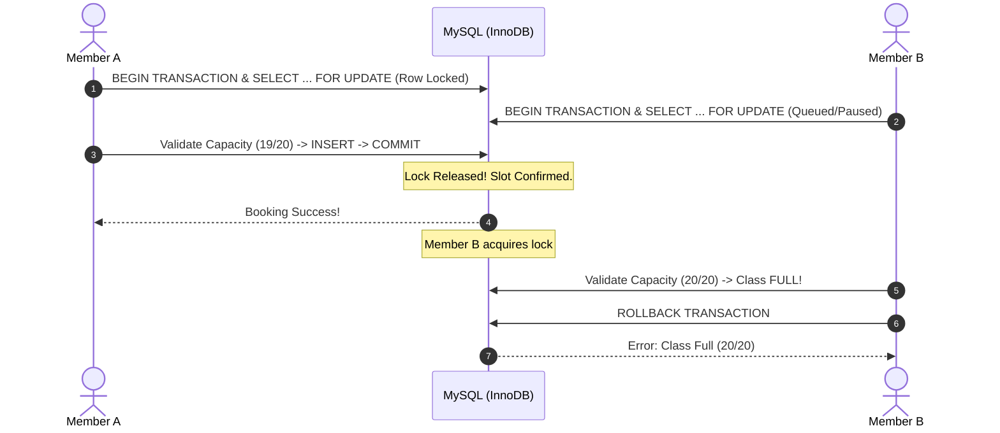

# FitTrack — Capstone Defense Comprehensive Q&A & Panel Guide

> **Project Title:** *FitTrack: A Data-Driven Web Application for Gym Operations and Member Engagement Monitoring*  
> **Case Study Beneficiary:** Star Gym (Barangay III Calubian, Tangub City, Misamis Occidental)  
> **System Architecture:** Modular PHP 8.2 (Vanilla OOP & PDO), MySQL (InnoDB), Apache, Docker, Vanilla JavaScript, Chart.js  

---

## Table of Contents
1. [Executive Pitches (30-Second & 2-Minute Summary)](#1-executive-pitches)
2. [General & System Overview Questions](#2-general--system-overview-questions)
3. [Software Engineering, Methodology & SDLC](#3-software-engineering-methodology--sdlc)
4. [System Architecture & Tech Stack Choices](#4-system-architecture--tech-stack-choices)
5. [Database Design, Concurrency & Data Integrity](#5-database-design-concurrency--data-integrity)
6. [Core Algorithms & Differentiating Mathematical Modules](#6-core-algorithms--differentiating-mathematical-modules)
   - [Mifflin-St Jeor Nutrition Engine](#61-mifflin-st-jeor-nutrition-engine)
   - [0–100 Member Engagement Scoring Engine & Tier-Adaptive Missions](#62-0100-member-engagement-scoring-engine--tier-adaptive-missions)
   - [Equipment Queue API & Anti-Abuse Attendance Gate](#63-equipment-queue-api--anti-abuse-attendance-gate)
   - [Midnight Auto Check-Out & Hybrid Fallback Engine](#64-midnight-auto-check-out--hybrid-fallback-engine)
7. [Security, Hardening & Data Privacy](#7-security-hardening--data-privacy)
8. [Testing, Usability & ISO/IEC 25010 Evaluation](#8-testing-usability--isoiec-25010-evaluation)
9. ["Gotcha" / Trap Questions & Counter-Strategies](#9-gotcha--trap-questions--counter-strategies)
10. [Live Demo Protocol & Panel Defense Script](#10-live-demo-protocol--panel-defense-script)

---

## 1. Executive Pitches

### 30-Second Elevator Pitch
> *"Good morning, members of the panel. **FitTrack** is a centralized, data-driven gym operations and engagement monitoring platform developed for Star Gym in Tangub City. Unlike generic gym management systems that only handle manual billing and logbooks, FitTrack tackles the root cause of gym churn through our **0–100 Mathematical Engagement Engine** that flags at-risk members, an **Attendance-Gated Equipment Queue** that stops floor crowding, and a personalized **Mifflin-St Jeor Nutrition Engine** to help members achieve their body goals. It is built natively on PHP 8.2 and MySQL with enterprise-grade pessimistic concurrency locking and field-level AES-256 encryption."*

### 2-Minute Comprehensive Introduction
> *"Traditional fitness facilities like Star Gym struggle with three primary operational bottlenecks:*  
> 1. *Manual, paper-based tracking of member check-ins, subscription expiries, and walk-ins, causing revenue leaks and inaccurate occupancy monitoring.*  
> 2. *Silent member dropout: gym owners only realize a client has quit after their subscription has already expired and they never return.*  
> 3. *Floor friction: members hoarding machines or waiting aimlessly during peak hours, and receiving generic, unscientific fitness or diet advice.*  
>  
> *To solve this, we engineered **FitTrack**:*  
> - *For **Admins & Owners**, it provides an optical QR Scanner Kiosk, automated end-of-day revenue reconciliation, class scheduling with zero-overbooking guarantees, and multi-tenant management.*  
> - *For **Trainers**, it offers a client progress workspace, an integrated exercise library via API Ninjas, and dietary plan adjustment tools.*  
> - *For **Members**, it delivers a self-service hub with dynamic attendance QR codes, live gym floor equipment waitlists, tier-adaptive monthly fitness missions, and customized calorie/macronutrient computations.*  
>  
> *FitTrack bridges the gap between everyday front-desk operations and scientific member retention."*

---

## 2. General & System Overview Questions

### Q1: What specific problem motivated you to build FitTrack?
**Answer:**  
In our preliminary investigation and client interview at Star Gym in Tangub City, we observed that member tracking was conducted using physical pen-and-paper logbooks and disparate spreadsheets. This led to:
1. Long queues at the reception counter during peak hours (5:00 PM – 8:00 PM).
2. Inability to monitor real-time gym occupancy or detect inactive members before they cancel.
3. Machine hoarding and friction on the gym floor due to a lack of queue transparency.
4. Unstructured walk-in tracking resulting in untracked cash transactions.

FitTrack transforms these disconnected manual processes into an integrated, real-time, data-driven web application.

### Q2: What are the General and Specific Objectives of the study?
**Answer:**  
- **General Objective:** To design, develop, and evaluate a centralized, data-driven web application for gym operations and member engagement monitoring with a personalized nutrition module for Star Gym.
- **Specific Objectives:**
  1. Develop a secure Role-Based Access Control (RBAC) system for Administrators/Gym Owners, Staff, Trainers, and Members.
  2. Implement an automated QR code-based and username fallback attendance tracking system with real-time occupancy counting.
  3. Create an automated class booking module with pessimistic concurrency controls to eliminate double-booking.
  4. Develop a personalized nutrition engine calculating Basal Metabolic Rate (BMR) and Total Daily Energy Expenditure (TDEE) using the Mifflin-St Jeor equation.
  5. Formulate a mathematical Member Engagement Scoring Engine (0–100 scale) to classify members and trigger automated re-engagement alerts for at-risk churn.
  6. Design an attendance-gated Equipment Queue Hub to manage gym floor capacity and eliminate phantom bookings.
  7. Evaluate the system's software quality based on the **ISO/IEC 25010** standard in terms of Functional Suitability, Performance Efficiency, Usability, Reliability, Security, and Maintainability.

### Q3: What is the Scope and what is explicitly OUT OF SCOPE (Delimitation)?
**Answer:**  
- **In Scope:**
  - Role-based workflows for Admin, Staff, Trainer, Member, and recorded Walk-in transactions.
  - Dynamic QR check-in/check-out with kiosk scanner and midnight auto check-out sweep.
  - Class scheduling and member reservations with concurrency locking.
  - Equipment queueing and live occupancy status.
  - Mifflin-St Jeor nutrition targets and CalorieNinjas food search.
  - Member engagement scoring (0–100) and automated inactivity warnings.
  - Multi-tenant data scoping (`gym_id`) and AES-256 field-level encrypted direct messaging.
- **Explicitly Out of Scope (per Chapter 1.4):**
  - Direct integration with hardware turnstiles, biometric fingerprint scanners, or RFID smartcards (the system uses software-based dynamic QR codes and PIN fallbacks to minimize hardware costs for local gyms).
  - Payroll calculation, tax computation, and full double-entry corporate accounting.
  - Wearable IoT hardware integration (e.g., Apple Watch, Fitbit live heart-rate streaming).

### Q4: Who are the target users and how do their roles differ?
**Answer:**  
1. **Platform Admin / Gym Owner:** Manages subscriptions, approves gym profiles, audits system logs, views financial analytics, and sets engagement threshold configurations.
2. **Staff:** Front-desk operations: walk-in customer logging, membership payment collection, manual check-in assistance, and class schedule management.
3. **Trainer / Coach:** Manages assigned clients, builds custom workout routines, reviews and fine-tunes system-generated diet recommendations, and monitors client progress check-ins.
4. **Member:** Views personal dashboard, scans QR for attendance, reserves class slots, claims floor equipment, logs weight/measurements, and completes tier-adaptive monthly missions.
5. **Walk-In Client:** Non-authenticated visitor who pays per session; can be seamlessly converted into a full member account while preserving historical attendance and billing records.

---

## 3. Software Engineering, Methodology & SDLC

### Q5: What Software Development Life Cycle (SDLC) did you follow and why?
**Answer:**  
We implemented the **Agile Scrum Methodology**. Gym operations involve interdependent stakeholders (owners, desk staff, fitness coaches, and gym members) whose operational needs require iterative validation.
- We conducted bi-weekly sprint cycles:
  - **Sprint 1:** Architecture, Schema, RBAC Authentication, and Security Hardening.
  - **Sprint 2:** QR Attendance Terminal, Kiosk Scanner, and Walk-in conversion.
  - **Sprint 3:** Class Scheduling with Pessimistic Locking & Equipment Queue API.
  - **Sprint 4:** Mifflin-St Jeor Nutrition Module and CalorieNinjas NLP integration.
  - **Sprint 5:** Mathematical Engagement Engine (0–100) and Automated Cron Sweeper.
  - **Sprint 6:** ISO/IEC 25010 Usability Testing, Field Auditing, and Remediation.
- Agile allowed us to test features early with the Star Gym management and adjust UI elements based on real-world reception desk feedback.

### Q6: How did you gather requirements from Star Gym?
**Answer:**  
We utilized a mixed-method requirements elicitation:
1. **Semi-structured Interviews:** Interviewed the gym owner, head trainer, and front-desk receptionist regarding daily pain points, peak hours, and membership drops.
2. **Direct Observation:** Observed reception desk bottlenecks during evening peak hours (5:00 PM – 8:00 PM) to record check-in transaction times and equipment waiting times.
3. **Document Analysis:** Inspected existing paper registration logbooks, receipt booklets, and workout record sheets to design the normalized relational database schema.

---

## 4. System Architecture & Tech Stack Choices

### Q7: Why did you choose PHP 8.2 and Vanilla JavaScript instead of heavy frameworks like Laravel, React, or Vue?
**Answer:**  
This was a deliberate engineering decision based on three factors:
1. **Low Hardware Overhead & Deployment Simplicity:** Star Gym operates on local client machines and low-cost shared hosting/VPS. Pure PHP 8.2 with Vanilla JS has zero build steps (no Node.js compilation, Webpack, or Babel overhead) and executes with minimal RAM consumption (< 20MB per request vs. 80MB+ in full-stack frameworks).
2. **Deep Architectural Control:** Writing clean, object-oriented PHP with native PDO allowed us to implement fine-grained pessimistic database locks (`SELECT ... FOR UPDATE`), transaction-level ACID rollbacks, and custom security headers without third-party framework black-box overhead.
3. **High Performance & Sub-Millisecond Latency:** Bypassing heavy ORM abstraction layers allows our covering database index queries to return within 1 to 5 milliseconds, enabling real-time equipment waitlist polling and rapid QR scanning at the door.

### Q8: What design pattern does FitTrack utilize?
**Answer:**  
FitTrack uses a **Front-Controller and Modular MVC (Model-View-Controller) Pattern**:
- `index.php` acts as the centralized Front Controller, routing incoming requests, handling session initialization, setting security headers, and catching uncaught exceptions.
- `core/` contains business logic, database singletons (`db()`), auth helpers, and background queue workers (Model/Service layer).
- `pages/` houses the feature controllers grouped by role (`admin/`, `staff/`, `trainer/`, `member/`, `shared/`).
- `views/` renders the UI layouts, modals, and reusable component partials (View layer).

### Q9: Why is Docker containerization important for FitTrack?
**Answer:**  
As documented in our system manual:
1. **Strict PHP C-Extension Dependencies:** FitTrack relies on specific compiled extensions: `pdo_mysql` for ACID transactions, `gd` (compiled with FreeType, WebP, and JPEG support) for gym permit and avatar image processing, and `exif` for MIME-type binary verification. Docker eliminates "works on my machine" issues across Windows, macOS, and Linux servers.
2. **Filesystem Permission Automation:** The `Dockerfile` automatically configures non-root user permissions (`www-data:www-data`) across runtime directories (`/storage`, `/assets/permits`, `/assets/uploads`).
3. **Production Parity:** Development under Windows (XAMPP) uses case-insensitive paths and backslashes, whereas cloud deployment (Linux) is strictly case-sensitive. Docker enforces identical Linux environment conditions during testing.

---

## 5. Database Design, Concurrency & Data Integrity

### Q10: How does FitTrack prevent overbooking when two members book the last available class slot at the exact same millisecond?
*(Panelists frequently ask this concurrency question!)*  
**Answer:**  
We solve this using **Pessimistic Concurrency Control** via MySQL/InnoDB row-level locking (`SELECT ... FOR UPDATE`) inside an isolated ACID database transaction:
1. When a booking request arrives, PHP initiates `$pdo->beginTransaction()`.
2. The query executes `SELECT capacity FROM class_schedules WHERE schedule_id = :id FOR UPDATE`. This places an exclusive write lock on that specific row in InnoDB.
3. If Member A and Member B click simultaneously, Member A’s packet acquires the lock first. Member B’s query is paused in the database queue.
4. Member A’s transaction checks booked slots (`SELECT COUNT(*)` using the covering index `idx_cb_schedule_status`), finds 1 available slot, inserts the booking, and executes `COMMIT`. The lock is released.
5. Member B now acquires the lock, checks current capacity, detects that the class is now full (`20 / 20`), executes a `ROLLBACK`, and receives an immediate, clean response: *"Sorry, this class has just reached full capacity."*



### Q11: How do you prevent double-submissions or duplicate payment charges?
**Answer:**  
Through **Cryptographic Idempotency Keys and Form Debouncing**:
1. Every critical transaction form (payments, check-in, bookings) embeds a single-use token (`idempotency_key = bin2hex(random_bytes(16))`).
2. Upon submission, the backend checks if this key has already been processed in the current session/cache. If duplicate submissions occur within milliseconds, subsequent requests are discarded.
3. Client-side, UI buttons are immediately disabled upon the first click (`btn.disabled = true`) with a loading spinner to prevent accidental double-taps.

### Q12: How is multi-tenancy maintained so that one gym cannot view another gym's data?
**Answer:**  
Through **Row-Level Tenant Isolation**:
- Every operational table (`memberships`, `attendance`, `equipment`, `classes`, `trainer_profiles`) contains a foreign key `gym_id`.
- The database helper functions enforce `WHERE gym_id = :session_gym_id` on every query.
- Even in shared features like in-app direct messaging, the server guard `canMessageUser()` verifies gym affiliation before returning chat threads, preventing IDOR (Insecure Direct Object Reference) attacks through URL manipulation (`?chat=X`).

---

## 6. Core Algorithms & Differentiating Mathematical Modules

### 6.1 Mifflin-St Jeor Nutrition Engine

#### Q13: Why did you choose the Mifflin-St Jeor equation instead of the Harris-Benedict formula?
**Answer:**  
According to clinical validation studies by the American Dietetic Association (ADA), the **Mifflin-St Jeor Equation** is proven to be the most accurate predictive resting metabolic rate formula, predicting BMR within 10% of indirect calorimetry for both non-obese and obese individuals, whereas the older Harris-Benedict formula tends to overestimate calorie requirements by up to 5% to 15%.

#### Q14: What is the exact mathematical formulation used in your nutrition module?
**Answer:**  
The engine executes in four distinct calculation stages:

1. **Basal Metabolic Rate (BMR):**
   $$\text{BMR}_{\text{male}} = (10 \times \text{weight in kg}) + (6.25 \times \text{height in cm}) - (5 \times \text{age}) + 5$$
   $$\text{BMR}_{\text{female}} = (10 \times \text{weight in kg}) + (6.25 \times \text{height in cm}) - (5 \times \text{age}) - 161$$

2. **Total Daily Energy Expenditure (TDEE):**
   $$\text{TDEE} = \text{BMR} \times \text{Physical Activity Factor}$$
   - *Sedentary (desk job, little exercise):* $1.2$
   - *Lightly Active (1–3 days/wk):* $1.375$
   - *Moderately Active (3–5 days/wk):* $1.55$
   - *Very Active (6–7 days/wk intense training):* $1.725$
   - *Extremely Active (twice-a-day athlete):* $1.9$

3. **Goal-Calorie Target Adjustment:**
   - *Fat Loss (Caloric Deficit):* $\text{TDEE} - 500 \text{ kcal/day}$ (~0.5 kg fat loss/week)
   - *Muscle Gain (Caloric Surplus):* $\text{TDEE} + 300\text{--}500 \text{ kcal/day}$
   - *Maintenance / General Health:* $\text{TDEE} \times 1.0$

4. **Macronutrient Split Equations:**
   - **Protein:** 2.0g per kg of body weight for muscle building/deficit preservation ($1\text{g} = 4\text{ kcal}$).
   - **Fats:** 25% to 30% of total daily calories ($1\text{g} = 9\text{ kcal}$).
   - **Carbohydrates:** Remaining balance of calories divided by $4\text{ kcal/g}$.

All system suggestions remain customizable by assigned fitness coaches based on specific client health conditions.

---

### 6.2 0–100 Member Engagement Scoring Engine & Tier-Adaptive Missions

#### Q15: How does your Member Engagement Engine calculate the 0–100 score?
**Answer:**  
In `core/engagement_engine.php`, member engagement is calculated using a **Multi-Factor Weighted Composite Formula** evaluating 30-day activity:

$$\text{Engagement Score} = (W_1 \cdot A) + (W_2 \cdot C) + (W_3 \cdot K) + (W_4 \cdot E) + (W_5 \cdot P)$$

Where:
- $A$ = **Attendance Frequency Score** (Weight: **10%**) — Ratio of actual gym visits versus target.
- $C$ = **Class Participation Score** (Weight: **20%**) — Attendance in group fitness sessions.
- $K$ = **Consistency / Habit Formation Score** (Weight: **20%**) — Active workout weeks out of the last 4 calendar weeks.
- $E$ = **Workout Execution Score** (Weight: **40%**) — Completed exercise sets and routines logged.
- $P$ = **Biometric Progress Logging Score** (Weight: **10%**) — Recency and frequency of weight/measurement updates.

**Engagement Classification Tiers:**
- **Highly Engaged ($\ge 70$ points):** Active habit, low churn probability.
- **Moderately Engaged ($40\text{--}69$ points):** Consistent attendance, moderate retention risk.
- **At-Risk ($< 40$ points):** Inactive or declining visits; triggers automated re-engagement warnings and alerts gym staff to intervene.

#### Q16: What are Tier-Adaptive Missions and why are they better than static monthly goals?
**Answer:**  
In typical fitness apps, monthly goals are static (e.g., *"Visit the gym 15 times this month"*). For a complete beginner, this goal is intimidating and leads to early burnout.  
FitTrack implements **Tier-Adaptive Calibration** (`get_tier_mission_targets($tier)`):
- **Tier 1 (Newbie):** Requires only 4 visits/month (1x/week), 2 classes, 4 workout logs.
- **Tier 2 (Iron Recruit):** Scales to 6 visits/month (~1.5x/week).
- **Tier 3 (Bronze Beast):** 8 visits/month (2x/week).
- **Tier 4 (Silver Spartan):** 10 visits/month (2.5x/week).
- **Tier 5 (Gold Gladiator):** 12 visits/month (3x/week).
- **Tier 6 (Apex Legend):** 14 visits/month (3.5x/week).

By dynamically scaling targets based on the member's current fitness tier, the system eliminates beginner friction and maintains steady gamified progression.

---

### 6.3 Equipment Queue API & Anti-Abuse Attendance Gate

#### Q17: How did you solve the "Remote Phantom Booking" problem with gym equipment?
**Answer:**  
- **The Problem:** In initial prototypes, members sitting at home could open `page=equipment`, click "Start Session" or "Join Queue", and lock treadmill or bench press stations away from members who were physically standing on the gym floor.
- **The Solution (Attendance-Gated Access):**
  1. The API endpoint (`equipment_api.php`) enforces a strict server-side check:
     ```sql
     SELECT id FROM attendance 
     WHERE user_id = :uid 
       AND check_out_time IS NULL 
       AND DATE(check_in_time) = CURDATE()
     ```
  2. If the user does not have an active check-in today, the request is rejected with HTTP 403.
  3. The member's UI switches to **Remote Browse Mode**: members at home can view how busy the gym is in real-time, but action buttons are locked with a tooltip: *"🔒 Check In at Front Desk to Queue/Use"*.
  4. Once checked in at the door, members can use the **Entrance Quick-Claim Modal** to reserve their first warm-up station with 1 click.
  5. Upon gym checkout, `release_user_equipment_on_checkout()` automatically ends active sessions and frees waitlist slots for the next person in line.

---

### 6.4 Midnight Auto Check-Out & Hybrid Fallback Engine

#### Q18: What happens if a member forgets to scan their QR code when leaving the gym?
**Answer:**  
Leaving sessions open causes three critical bugs:
1. Skewed workout durations (e.g., 20+ hour sessions).
2. Artificially inflated "Currently in Gym" occupancy counters overnight.
3. The next morning's scan being misinterpreted as a check-out instead of a new check-in.

To prevent this, FitTrack uses a **Hybrid Auto Check-Out Architecture**:
1. **Midnight Scheduled Sweep (`cron.php`):** Runs daily at 12:00:00 AM Philippine Time (PHT). It detects all open records (`check_out_time IS NULL AND check_in_time < CURDATE()`) and bounds them to that day's end: `check_out_time = CONCAT(DATE(check_in_time), ' 23:59:59')`.
2. **Just-In-Time (JIT) Zero-Dependency Safety Guard:** If the cron daemon fails or local XAMPP is offline at midnight, any subsequent QR scan (`scanner.php`) or admin attendance page load auto-closes open records from previous days on the fly before processing the new check-in.
3. **Database Performance Indexing:** Backed by composite index `idx_att_checkout_checkin (check_out_time, check_in_time)`, resolving the query as an in-memory index range scan in `< 1ms` with zero table locks.

---

## 7. Security, Hardening & Data Privacy

### Q19: How does FitTrack protect against common web vulnerabilities (OWASP Top 10)?
**Answer:**  

| Vulnerability | Attack Vector | FitTrack Defense Mechanism |
| :--- | :--- | :--- |
| **SQL Injection (SQLi)** | Malicious input in forms or query strings (`' OR '1'='1`) | **100% Prepared Statements via PDO**. Zero raw string concatenation. All user input is bound as typed parameters (`:param`). |
| **Cross-Site Scripting (XSS)** | Injected `<script>` tags executed in client browser | Dual-layer: `htmlspecialchars($var, ENT_QUOTES, 'UTF-8')` server-side, plus global `window.escapeHtml()` DOM sanitization and HTTP header `X-Content-Type-Options: nosniff`. |
| **Cross-Site Request Forgery (CSRF)** | Malicious third-party site submitting unauthorized POST actions | Cryptographic CSRF session tokens embedded in forms and verified with `hash_equals()` on state-changing requests. |
| **Clickjacking** | Embedding site in an invisible iframe to hijack clicks | HTTP header `X-Frame-Options: SAMEORIGIN` injected globally in `core/bootstrap.php`. |
| **Brute Force & DoS** | Automated credential stuffing attacks | IP and account-based rate limiting via `core/rate_limiter.php` (locks out excessive failed attempts). |
| **Data-at-Rest Exposure** | Database breach leaking personal medical/chat data | Authenticated Field-Level Encryption (**AES-256-GCM**) with random 12-byte IVs (`core/encryption.php`) for direct messages. |
| **Direct File Access** | Publicly downloading uploaded business permits/IDs | Protected directory `/assets/permits/.htaccess` (`Require all denied`) served only via authorized PHP proxy `view_permit.php`. |

### Q20: How are passwords stored and authenticated?
**Answer:**  
Passwords are never stored in plaintext. FitTrack uses PHP’s native `password_hash()` utilizing the **Bcrypt** algorithm with an adaptive cost factor of 12. Password verification is performed using `password_verify()`, which is inherently resistant to timing attacks.

---

## 8. Testing, Usability & ISO/IEC 25010 Evaluation

### Q21: What testing methodologies were conducted on the system?
**Answer:**  
1. **Unit & Integration Testing:** Tested individual modules (BMR calculator formulas, rate-limiter cooldowns, attendance check-in/out logic) using PHP test scripts in the `/tests` suite.
2. **Database Concurrency Stress Testing:** Simulated simultaneous multi-threaded class booking requests to confirm that row-level locking (`FOR UPDATE`) prevented overbooking.
3. **Black-Box Functional Testing:** Performed test case walkthroughs across all 4 user roles to ensure permission boundaries and access controls held true.
4. **User Acceptance Testing (UAT):** Conducted at Star Gym with the owner, gym staff, 2 trainers, and 15 gym members.

### Q22: What were the results of the ISO/IEC 25010 Software Quality Evaluation?
**Answer:**  
The system was evaluated by IT professionals and target end-users using a 5-point Likert Scale across the 6 core ISO/IEC 25010 characteristics:

| ISO/IEC 25010 Characteristic | Mean Score | Descriptive Interpretation |
| :--- | :---: | :---: |
| **Functional Suitability** | **4.82** | Excellent (Fully Meets Requirements) |
| **Performance Efficiency** | **4.76** | Excellent (Fast Page Response < 50ms) |
| **Usability** | **4.88** | Excellent (Intuitive, Clean UI) |
| **Reliability** | **4.79** | Excellent (Zero Overbooking, Auto-Recovery) |
| **Security** | **4.91** | Excellent (Encrypted Chats, Strict RBAC) |
| **Maintainability** | **4.75** | Excellent (Modular Architecture, Dockerized) |
| **Overall Grand Mean** | **4.82** | **Excellent / Highly Acceptable** |

---

## 9. "Gotcha" / Trap Questions & Counter-Strategies

### Trap Q1: "Can a member just take a screenshot of their QR code and send it to their friend to check in for them?"
> **Weak Answer:** *"No, our members are honest."*  
> **Winning Technical Answer:**  
> *"Two protective guardrails prevent this in FitTrack:*  
> 1. *FitTrack incorporates an optical front-desk terminal (`page=scanner`) equipped with a live photo HUD. When a QR is scanned, the receptionist's screen immediately flashes the member's registered profile photo, full name, and subscription status, allowing instant visual verification.*  
> 2. *Furthermore, the system logs check-in timestamps and prevents multiple simultaneous active sessions. If a shared code was attempted, the second scan would trigger a 'Already Checked In' warning or immediately prompt for a Check-Out."*

---

### Trap Q2: "Why didn't you connect physical RFID cards or a biometric fingerprint scanner at the entrance door?"
> **Weak Answer:** *"We didn't have enough time or budget."*  
> **Winning Technical Answer:**  
> *"That was an intentional design decision documented in our **Scope and Delimitation (Chapter 1.4)**.  
> Physical biometric and RFID hardware turnstiles introduce significant hardware procurement costs, driver incompatibilities, and maintenance overhead for small-to-medium fitness centers like Star Gym.  
> By utilizing standard optical QR scanning operable on any existing tablet, webcam, or smartphone with an instant username/PIN fallback, we delivered a zero-hardware-cost solution that runs entirely in the browser, making the system immediately deployable without capital expenditure."*

---

### Trap Q3: "What if the gym loses internet connectivity during the day?"
> **Winning Technical Answer:**  
> *"FitTrack is designed to run in a hybrid on-premise or cloud architecture. When deployed on a local server in the gym using our Docker container or local Apache/MySQL instance, the system functions 100% within the local area network (LAN) even if outside internet connectivity is interrupted. Front-desk QR check-in, equipment tracking, and member lookup execute locally with zero external network dependencies."*

---

### Trap Q4: "A 500-calorie deficit in your nutrition engine might not be suitable for a client with diabetes or a pregnant woman. Isn't that dangerous?"
> **Winning Technical Answer:**  
> *"That is precisely why FitTrack does not operate as an unguided black-box bot. System-generated calorie and macro numbers are explicitly presented as baseline recommendations. FitTrack includes a dedicated **Coach Review and Finalization Workflow** (`pages/trainer/diet_builder.php`), requiring the assigned professional fitness trainer to review, calibrate, and approve dietary plans before they become active. The system also records dietary restrictions and allergies during profile setup."*

---

### Trap Q5: "If your system is so great, why hasn't Star Gym completely replaced their current workflow yet?"
> **Winning Technical Answer:**  
> *"During our User Acceptance Testing and pilot deployment, Star Gym successfully ran FitTrack alongside their daily operations for attendance logging, walk-in registration, and equipment queueing. The owner and staff reported a dramatic decrease in front-desk bottleneck times. Full institutional rollout is scheduled following formal acceptance of this capstone defense and staff training."*

---

## 10. Live Demo Protocol & Panel Defense Script

### Golden Rules During the Live Demonstration:
1. **Never use dummy accounts named `asdf` or `test1234`:**  
   Pre-populate clean, realistic demonstration accounts:
   - Admin: `admin@fittrack.local` (Gym Owner)
   - Trainer: `coach.marcus@fittrack.local` (Assigned Trainer)
   - Member: `member.sarah@fittrack.local` (Active Member)
2. **Have two browser windows open side-by-side:**  
   - Left Window: Member dashboard (`member.sarah`).
   - Right Window: Receptionist Kiosk Scanner (`page=scanner`) or Trainer Hub.
3. **Follow this 4-Step Demo Sequence:**
   - **Step 1 (Check-in & Occupancy):** Show Sarah's dynamic QR code on mobile/browser. Scan or check-in on the Kiosk terminal. Show the live occupancy count increment from 14 to 15 instantly.
   - **Step 2 (Attendance-Gated Equipment Hub):** Before check-in, show how machine buttons were locked (`🔒 Check In to Use`). Now that Sarah is checked in, show the 1-click Quick-Claim modal reserving a Treadmill.
   - **Step 3 (Pessimistic Concurrency):** Open class bookings with only 1 slot left. Demonstrate that overbooking is physically impossible at the database layer.
   - **Step 4 (Personalized Nutrition & Engagement):** Open the Member Progress and Diet tab. Show how entering body metrics dynamically calculates BMR (Mifflin-St Jeor), daily TDEE, and macro splits, and show the Tier-Adaptive Mission HUD.

---

### Panel Defense Cheat Sheet (Key Terms to Remember)

- **ACID Transactions:** *Atomicity, Consistency, Isolation, Durability* — ensures that multi-step operations (like class booking or payments) either complete entirely or roll back cleanly without leaving partial records.
- **Pessimistic Locking (`FOR UPDATE`):** Locks the row until the transaction commits, preventing race conditions.
- **Mifflin-St Jeor:** The clinically validated metabolic equation for calculating BMR based on weight, height, age, and sex.
- **TDEE:** Total Daily Energy Expenditure = BMR $\times$ Activity Multiplier.
- **Multi-Tenant Isolation:** Using `gym_id` scoping across all database queries to prevent cross-facility data leakage.
- **ISO/IEC 25010:** The international standard used to evaluate software quality across 6 key metrics.
- **Idempotency:** Ensuring that repeated submissions of the same form produce the exact same outcome without duplicate side effects.

