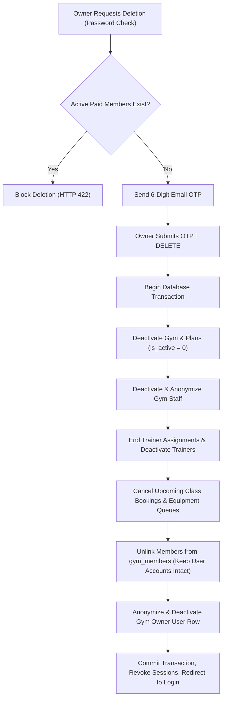

# Gym Owner Account Deletion & Facility Teardown Specification

## 1. Executive Summary

In FitTrack, a commercial gym is owned and operated by a user with the `gym_owner` role. When a gym owner decides to permanently delete their account, it represents the complete closure and decommissioning of that gym facility on the platform.

Because fitness facilities operate with staff, trainers, paying members, and historical accounting data, a simple deletion of the owner's row would leave orphaned employee accounts, broken memberships, or foreign key errors. 

This document defines the cascading account lifecycle, guardrails, and privacy protection protocols executed when a gym owner deletes their account.

---

## 2. Business Rules & Role Lifecycle Matrix

| Entity | Action on Gym Owner Deletion | Rationale |
| :--- | :--- | :--- |
| **Gym Owner** | **Deactivated & Anonymized** (`status = 'inactive'`, `Deleted Owner`, email anonymized) | Revokes login privileges permanently while maintaining historical integrity for financial audit logs, platform billing, and revenue reports. |
| **Gym Facility** | **Deactivated** (`status = 'rejected'`, `subscription_status = 'expired'`) | Immediately removes the facility from public search, directories, and geolocation maps. |
| **Membership Plans** | **Archived** (`is_active = 0`) | Prevents any new subscriptions or renewals from being purchased. |
| **Gym Staff** | **Deactivated & Disassociated** (`gym_staff` unlinked; `status = 'inactive'`, `Deleted Staff`, email anonymized) | Staff accounts exist solely to operate that facility (front desk, attendance). Once the facility closes, staff accounts have no standalone utility. |
| **Trainers** | **Deactivated & Disassociated** (`trainer_profiles` removed; `trainer_assignments` marked `ended`; `status = 'inactive'`, `Deleted Trainer`) | Trainers hired by this facility lose their operating context. Active client coaching assignments are gracefully closed. |
| **Classes & Schedules** | **Cancelled** (Pending/Booked bookings marked `cancelled`) | Clears upcoming scheduled sessions and releases user slots. |
| **Equipment Queues** | **Cancelled** (`waiting` queues marked `cancelled`) | Releases all active equipment hold queues. |
| **Members** | **Preserved & Disaffiliated** (`gym_members` join row deleted; gym memberships marked `cancelled`) | **Members are independent fitness platform users.** Members maintain their accounts, logins, workout logs, dietary plans, macros, body metrics, and progress logs untouched so they can use FitTracks independently or join another gym. |

---

## 3. Security & Anti-Fraud Guardrails

### 3.1 Financial Guardrail: Active Paid Member Protection
A gym owner **cannot** delete their account while paying members have active, unexpired subscriptions:
- **Condition:** If `COUNT(memberships)` where `status = 'active'` and `end_date >= CURDATE()` is greater than 0:
  - Account deletion is strictly **blocked** with HTTP 422.
  - An informative warning message states how many active paid members remain.
  - The gym owner must wait for subscriptions to lapse or resolve member commitments before deleting.

### 3.2 Two-Factor Email OTP Verification
Account deletion is protected behind high-security verification:
1. **Password Authentication:** The gym owner must enter their current account password.
2. **Rate-Limited Email OTP:** A 6-digit numeric OTP code is generated, hashed, and sent to the owner's registered email address.
   - Rate limit: Maximum 3 OTP requests per 10 minutes.
   - Verification attempts: Maximum 5 failed attempts per 10 minutes.
   - OTP validity: 10 minutes.
3. **Explicit Confirmation:** The user must explicitly type the word `DELETE`.

---

## 4. Technical Execution Flow (`pages/member/profile_actions.php`)



### 4.1 Safe Anonymization Implementation
To prevent database foreign key constraint failures (e.g. historical audit logs, past attendance checkouts, and payment records), user accounts are safely neutralized rather than hard-deleted:

```php
$anonymizeUser = static function (int $targetId, string $targetRole, string $label) use ($pdo, $userCols): void {
    $anonEmail = 'deleted_' . $targetRole . '_' . $targetId . '_' . time() . '@deleted.local';
    $updateFields = [
        'first_name = "Deleted"',
        'last_name = ?',
        'email = ?',
        'phone = NULL',
        'password_hash = ""',
        'profile_picture = NULL',
        'status = "inactive"'
    ];
    $updateParams = [$label, $anonEmail];
    
    // Clear Google OAuth, QR check-in tokens, and active session tokens
    if (in_array('google_id', $userCols, true)) $updateFields[] = 'google_id = NULL';
    if (in_array('qr_token', $userCols, true)) $updateFields[] = 'qr_token = NULL';
    if (in_array('session_token', $userCols, true)) $updateFields[] = 'session_token = NULL';
    
    $updateParams[] = $targetId;
    $pdo->prepare('UPDATE users SET ' . implode(', ', $updateFields) . ' WHERE user_id = ?')->execute($updateParams);
};
```

---

## 5. Member Experience Post-Decommissioning

When a gym owner deletes their gym:
1. Members are no longer affiliated with that gym (`gym_members` entry removed).
2. The gym disappears from their active facility dropdown.
3. **All member fitness data remains accessible:**
   - Exercise history & completion logs
   - Daily macro logs & customized food items
   - Weight & body fat measurement records
   - Custom self-guided workouts & dietary plans
4. Members can browse the Gym Directory to join a new facility at any time.

---

## 6. Database Optimization & Indexes

Database queries executed during teardown are indexed via `migrate.php`:
- `idx_gym_staff_gym_user` on `gym_staff(gym_id, user_id)`
- `idx_trainer_gym_user` on `trainer_profiles(gym_id, user_id)`
- `idx_class_sched_gym_class` on `class_schedules(gym_id, class_id)`

