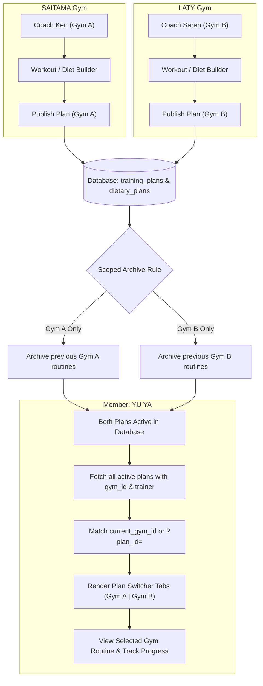

# Multi-Gym & Multi-Trainer Plan Scoping (Gym-Scoped Workouts & Diets)

## 1. Overview & Context

In FitTracks, members can belong to or train across multiple gym branches (e.g. affiliated with **SAITAMA Gym** and **LATY Gym**). In addition, each gym can independently assign personal trainers to the member.

### Previous Challenge (Global Overwrite)
Previously, training plans (`training_plans`) and diet plans (`dietary_plans`) operated under a global single-active rule per member:
- When a trainer at Gym B published a routine, the system executed:
  ```sql
  UPDATE training_plans SET status = 'archived' WHERE member_user_id = ? AND status = 'active';
  UPDATE dietary_plans SET status = 'completed' WHERE member_user_id = ? AND status = 'active';
  ```
- This inadvertently archived and wiped out the active routine and diet plan published by Gym A's trainer.
- Members visiting Gym A could no longer view Gym A's equipment-tailored exercises, and Gym A's trainer lost their active client regimen.

---

## 2. Architectural Solution: Gym-Scoped Plans with Switcher

FitTracks implements **Gym-Scoped Plan Isolation with an Interactive Member Switcher**:

1. **Isolation on Publish**: When a trainer or gym owner publishes a workout or diet plan, the system archives **only** active plans belonging to **their specific gym facility or trainer profile**. Routines from other gyms remain active.
2. **Draft Separation**: Work-in-progress drafts and cloning are scoped to the trainer and gym facility so trainers from different gyms never overwrite each other's drafts.
3. **Smart Member Auto-Selection**: When the member opens **My Workout** or **Diet**, the page automatically loads the plan matching their currently selected gym session (`get_user_gym()` / `current_gym_id`), falling back to the newest active plan.
4. **Interactive Member Switcher**: If a member has active programs across multiple gyms (e.g., SAITAMA and LATY), a multi-plan switcher card appears at the top of the screen, allowing instant toggling between gym routines.

---

## 3. Workflow & Data Flow Diagram



---

## 4. Technical Implementation Details

### A. Workout Builder (`pages/trainer/workout_builder.php`)
When publishing a workout plan, the query now joins `trainer_profiles` to verify gym scope:
```php
// Archive old active plans strictly for this trainer or this trainer's gym facility
if ($trainerGymId > 0) {
    $pdo->prepare('
        UPDATE training_plans tp
        LEFT JOIN trainer_profiles tp_prof ON tp.trainer_id = tp_prof.trainer_id
        SET tp.status = "archived"
        WHERE tp.member_user_id = ? 
          AND tp.status = "active" 
          AND (tp.trainer_id = ? OR tp_prof.gym_id = ?)
    ')->execute([$memberId, $trainerId, $trainerGymId]);
} else {
    $pdo->prepare('UPDATE training_plans SET status = "archived" WHERE member_user_id = ? AND trainer_id = ? AND status = "active"')
        ->execute([$memberId, $trainerId]);
}
// Set draft to active
$pdo->prepare('UPDATE training_plans SET status = "active", start_date = ?, end_date = ? WHERE plan_id = ?')
    ->execute([$startDate, $endDate, $planId]);
```

### B. Diet Builder (`pages/trainer/diet_builder.php`)
1. **Draft Scoping**:
   ```php
   // Scoped to member AND (trainer_id OR gym_id)
   SELECT dp.* FROM dietary_plans dp 
   LEFT JOIN trainer_profiles tp ON dp.trainer_id = tp.trainer_id 
   WHERE dp.member_user_id = ? AND (dp.trainer_id = ? OR tp.gym_id = ?) AND dp.status = "draft"
   ORDER BY dp.plan_id DESC LIMIT 1
   ```
2. **Scoped Publishing**:
   ```php
   // Only complete existing active plans belonging to the publisher's gym facility
   UPDATE dietary_plans dp
   LEFT JOIN trainer_profiles tp ON dp.trainer_id = tp.trainer_id
   SET dp.status = "completed"
   WHERE dp.member_user_id = ? 
     AND dp.status = "active" 
     AND (dp.trainer_id = ? OR tp.gym_id = ?)
   ```

### C. Member Workout Portal (`pages/member/my_workout.php`)
* **Multi-Plan Query**:
  ```sql
  SELECT p.*, tp.user_id AS t_user_id, u.first_name AS t_first, u.last_name AS t_last,
         tp.gym_id, g.name AS gym_name
  FROM training_plans p 
  LEFT JOIN trainer_profiles tp ON p.trainer_id = tp.trainer_id 
  LEFT JOIN users u ON u.user_id = tp.user_id 
  LEFT JOIN gyms g ON g.gym_id = tp.gym_id
  WHERE p.member_user_id = ? AND p.status = "active" 
  ORDER BY p.plan_id DESC
  ```
* **Smart Resolution**:
  1. Checks URL parameter `$_GET['plan_id']`.
  2. If absent, matches the member's current active gym (`current_gym_id`).
  3. Falls back to the latest active plan.
* **Month Navigation Retention**: Pagination links (`&month=YYYY-MM`) append `&plan_id=...` so browsing past/future months stays on the selected gym's routine.
* **Per-Plan Exercise Completions**: Exercise completions in `exercise_completions` remain filtered by `plan_id`, preventing workout logs from colliding between gyms.

### D. Member Diet Portal (`pages/member/diet.php`)
* Retrieves all active diet plans with trainer and gym info.
* Provides the identical switcher experience, enabling members to toggle between nutritional regimens prescribed by different gym trainers.

### E. Frontend Design System (`my_workout.css` & `diet.css`)
* `.plan-switcher-container`: Glassmorphism panel with subtle borders and 14px radius.
* `.plan-switcher-pill`: Interactive pills displaying:
  * Gym name
  * Coach name
  * `Selected Gym` badge (if matching active session gym)
  * Animated pulsing dot + `Viewing` label for the active tab.

### F. Member Sidebar & Navigation Scoping (`views/layout.php`, `profile.php`, `trainers.php`)
* **Profile Nav Membership Pill**: Scoped by the currently active facility (`mp.gym_id = $activeGymId`). Members viewing a facility where they have not purchased a subscription no longer display another facility's plan name (e.g., viewing Laty won't show Saitama's "Quarterly Plus").
* **Trainer Sidebar & Assignment Badges**: Scoped by the active gym (`tp.gym_id = $activeGymId`). Only indicates active personal trainer status if the member has an assigned trainer at the active facility.
* **Profile Gym Affiliation Card**: Displays the active facility name and verifies whether an active membership exists specifically at that facility.

---

## 5. Verification Matrix

| Scenario | Prior Behavior | New Behavior |
| :--- | :--- | :--- |
| **LATY gym publishes workout plan for YU YA** | SAITAMA gym workout plan was marked `archived` and vanished. | SAITAMA workout plan remains `active`. Both coexist in the database. |
| **Member visits `my_workout.php`** | Only showed whichever plan was published last. | Shows currently selected gym's plan by default, plus a top switcher tab if multiple active plans exist. |
| **LATY gym trainer edits diet draft** | Overwrote SAITAMA trainer's un-published draft. | Drafts are isolated per gym/trainer; neither interferes with the other. |
| **Logging workout exercises** | Shared or overwrote completion states. | Completions are tied strictly to `plan_id` in `exercise_completions`. |
| **Profile Nav Badge with LATY Active** | Showed SAITAMA's `QUARTERLY PLUS` even though LATY has no subscription paid. | Scoped to LATY (`mp.gym_id = 9`). No false plan badge shown until subscribed at LATY. Swapping to SAITAMA restores `QUARTERLY PLUS`. |
| **Trainer Badge with LATY Active** | Showed `ACTIVE` badge because member had a coach at SAITAMA. | Scoped to LATY; shows no active coach badge unless assigned a coach at LATY. |
