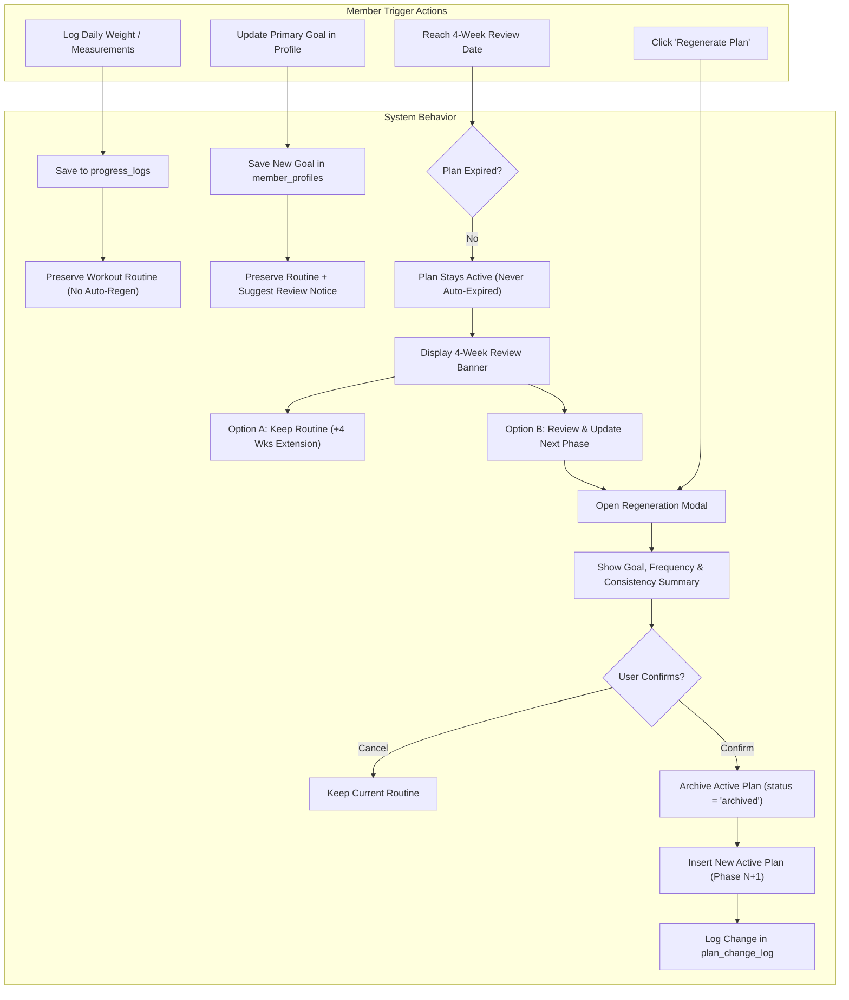

# Self-Guided Workout Plan Adjustment, Review & Archiving System

## 1. Overview & Core Philosophy

In FitTrack, members follow one of two training paradigms:
1. **Self-Guided Members**: Independent gym members who train on their own using system-generated exercise programs.
2. **Coached / Trainer-Guided Members**: Members working with an assigned personal coach. Their training programs and dietary plans are customized and published directly by their coach. **Automated system recalculations must never overwrite or replace a coach's training regimen.**

### The Problem with Immediate Auto-Regeneration
Historically, when a self-guided member logged body measurements (e.g., scale weight, waist size), the system would immediately delete and regenerate their active workout plan. This caused several critical issues:
* **Destroyed Progressive Overload**: Physical adaptation requires sticking to the same movement patterns for 4 to 8 weeks so weights and reps can be progressively increased.
* **Routine Whiplash**: Natural daily scale fluctuations (±0.5 kg to 2.0 kg from water/digestion) caused exercises and schedules to shuffle unexpectedly overnight.
* **Loss of Historical Context**: Previous workout plans were permanently deleted with raw SQL `DELETE`, orphaning workout history.

### The Modernized Solution
FitTrack separates **Progress Logging** from **Plan Regeneration**. Daily progress logs continuously populate charts and milestones without altering the member's established workout routine. Plan adjustments now run on **predictable 4-week mesocycles** with explicit member confirmation and non-destructive plan version archiving.

---

## 2. Classification Logic

A member is classified as **Trainer-Guided** (not self-guided) if:
- They have an active trainer assignment in `trainer_assignments` (`status = 'active'`), **OR**
- They have an active workout plan authored by a trainer (`training_plans.trainer_id IS NOT NULL AND status = 'active'`).

Otherwise, the member is classified as **Self-Guided**.

### Core Functions (`pages/shared/workouts.php`):
- `is_member_self_guided(int $memberUserId): bool`: Single source of truth to check if a member is self-guided.
- `get_member_active_trainer_user_id(int $memberUserId): ?int`: Retrieves the user ID of the assigned trainer to route notifications.
- `can_recalculate_workout(int $memberUserId): bool`: Alias checking eligibility for self-guided updates.

---

## 3. Workflow & Trigger Safeguards

| Trigger | Self-Guided Member | Coached Member |
| :--- | :--- | :--- |
| **Progress Logging** (`pages/member/progress.php` & `equipment_api.php`) | **Saves stats only.** Updates Progress Hub metrics and awards milestone notifications. **Preserves the active workout plan untouched.** | **Saves stats only.** Notifies assigned coach: *"Client [Name] logged new body measurements. Review their training program if adjustments are needed."* |
| **Profile Goal Update** (`pages/member/profile_actions.php`) | **Saves new goal & preserves current routine.** Sends in-app notice: *"You updated your fitness goal to [Goal]. Your current workout plan is preserved. You can review and regenerate an updated routine anytime in My Workout."* | **Preserves coach's routine.** Sends notification to assigned coach: *"Client [Name] updated their primary fitness goal to [Goal]. Review and update their training routine when convenient."* |
| **Scheduled 4-Week Review** (`pages/member/my_workout.php`) | When review date (`end_date <= today`) arrives, the plan **remains fully active and usable**. A **4-Week Review Banner** appears offering: <br>1. **Keep Current Routine (+4 Wks)** (`action=extend_cycle`) <br>2. **Update to Next Phase** (Opens Confirmation Modal) | Managed exclusively by coach. Coach receives client milestone reviews. |
| **Manual Plan Regeneration** (`pages/member/my_workout.php`) | Accessible via "Regenerate Plan" / "Update Routine". Opens interactive **Confirmation Modal** displaying goals, frequency, and monthly consistency. Upon confirmation, archives previous plan (`status='archived'`) and generates Phase $N+1$. | **Disabled with locked "Coach Managed" indicator.** Tooltip explains plan is managed by assigned coach. Backend POST handler rejects unauthorized overrides. |
| **Performance Tracking** (`pages/member/my_workout.php`) | When monthly completion rate is high ($\ge 80\%$ with $\ge 5$ workouts), displays an **Optional Progressive Overload Suggestion** recommending $+2.5\text{ kg}$ or $+1\text{--}2$ reps without modifying routine. Includes a dismiss button. | Monitored by coach via Trainer Dashboard analytics. |

---

## 4. Architecture & Lifecycle Flow



---

## 5. Database Schema & Migration Changes

Documented in [`migrate.php`](file:///c:/xampp/htdocs/Fittracks_before_test/migrate.php#L233-L238):

```sql
-- 1. Ensure 'archived' status enum is officially supported in training_plans
ALTER TABLE training_plans 
  MODIFY COLUMN status ENUM('active','completed','archived','draft','upcoming','paused') NOT NULL DEFAULT 'draft';

-- 2. Performance index for active and archived plan lookups by member and review date
CREATE INDEX idx_tp_member_status_end 
  ON training_plans (member_user_id, status, end_date);

-- 3. Performance index for completed exercise history across plan cycles
CREATE INDEX idx_ex_comp_user_plan 
  ON exercise_completions (user_id, plan_id, completed_date);
```

### Plan Archiving vs. Deletion
In [`pages/shared/workouts.php`](file:///c:/xampp/htdocs/Fittracks_before_test/pages/shared/workouts.php#L420-L426), destructive `DELETE` queries were replaced with non-destructive status updates:

```php
// Before (Destructive):
// $pdo->prepare('DELETE FROM training_plans WHERE member_user_id = ? AND trainer_id IS NULL AND gym_id = ?')->execute([...]);

// After (Non-destructive version archiving):
$pdo->prepare('UPDATE training_plans SET status = "archived" WHERE member_user_id = ? AND trainer_id IS NULL AND gym_id = ? AND status = "active"')
    ->execute([$memberUserId, $scopedGymId]);
```

This guarantees:
1. Historical completions in `exercise_completions` remain linked to their original `plan_id`.
2. Members and coaches can review past phases, volume progression, and performance over time.
3. Database foreign key integrity and audit logs (`plan_change_log`) remain consistent.

---

## 6. Test Suite & Verification

The suite in [`tests/self_guided_plan_review_test.php`](file:///c:/xampp/htdocs/Fittracks_before_test/tests/self_guided_plan_review_test.php) (integrated into `php tests/run.php`) verifies:

1. **Initial Generation**: Plan initializes with `status = 'active'` and a review window of approximately 28 days (`DATE_ADD(CURDATE(), INTERVAL 4 WEEK)`).
2. **Decoupled Logging**: Logging weight and body measurements preserves active `plan_id` without triggering regeneration.
3. **Non-Destructive Review Date**: When `end_date` arrives, plan status remains `active`. Testing `action=extend_cycle` successfully extends `end_date` by +4 weeks.
4. **Version Archiving**: Manual regeneration transitions the previous plan to `archived` and creates the next phase as `active` without deleting history.
