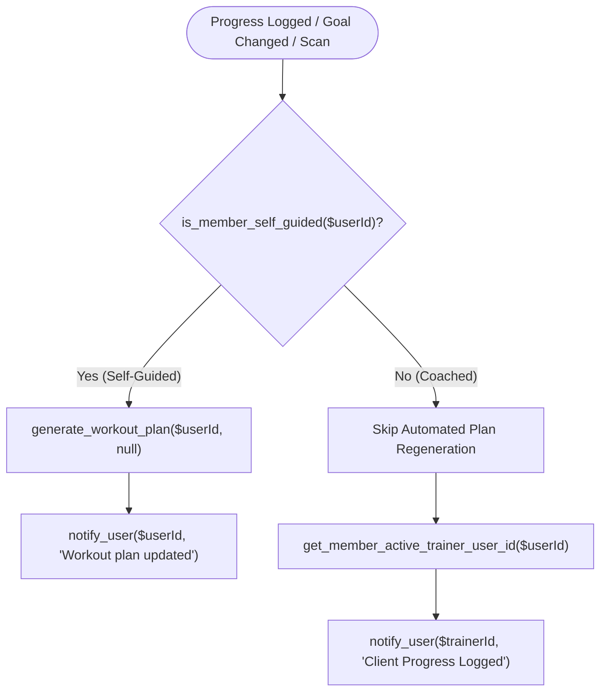

# Self-Guided vs. Coached Workout & Diet Plan Automation

## 1. Overview & Business Logic

In FitTracks, members follow one of two training paradigms:
1. **Self-Guided Members**: Independent gym members who train on their own. Their exercise routines and nutritional benchmarks automatically adapt whenever they log physical progress (weight, body measurements) or update their fitness goals.
2. **Coached / Trainer-Guided Members**: Members who have an assigned personal trainer or coach. Their training programs and dietary plans are customized and published directly by their coach. **Automated system recalculations must never overwrite or replace a coach's training regimen.**

---

## 2. Classification Logic

A member is classified as **Trainer-Guided** (not self-guided) if:
- They have an active trainer assignment in `trainer_assignments` (`status = 'active'`), **OR**
- They have an active workout plan created by a trainer (`training_plans.trainer_id IS NOT NULL AND status = 'active'`).

Otherwise, the member is classified as **Self-Guided**.

### Core Functions (`pages/shared/workouts.php`):
- `is_member_self_guided(int $memberUserId): bool`: Single source of truth to check if a member is self-guided.
- `get_member_active_trainer_user_id(int $memberUserId): ?int`: Retrieves the user ID of the assigned trainer to route notifications.
- `can_recalculate_workout(int $memberUserId): bool`: Direct alias to `is_member_self_guided($memberUserId)`.

---

## 3. Automation Safeguards by Trigger

| Trigger | Self-Guided Member | Coached Member |
| :--- | :--- | :--- |
| **Progress Logging** (`pages/member/progress.php`) | Recalculates routine based on new metrics & notifies member. | **Preserves coach's routine.** Sends a high-priority notification to the assigned trainer: *"Client [Name] logged new body measurements. Review their training program if adjustments are needed."* |
| **Profile Goal Update** (`pages/member/profile_actions.php`) | Recalculates routine according to new primary goal. | **Preserves coach's routine.** Sends a notification to the assigned trainer: *"Client [Name] updated their primary fitness goal to [Goal]. Review and update their training routine when convenient."* |
| **Manual Workout Plan Regeneration** (`pages/member/my_workout.php`) | Displays active **"Regenerate Plan"** button with confirmation modal. | **Button is disabled & replaced with a locked "Coach Managed" indicator.** Tooltip informs member: *"Your workout routine is managed by your assigned coach ([Name]). Contact your coach for plan adjustments."* Backend POST handler also blocks any direct request. |
| **Manual Diet Plan Regeneration** (`pages/member/diet.php`) | Displays active **"Regenerate Plan"** button. | **Button is disabled & replaced with locked "Coach Managed" indicator.** Backend handler prevents overriding trainer meal plans. |
| **Kiosk / RFID Equipment Scan** (`pages/shared/equipment_api.php`) | Auto-optimizes workout routine. | Routine preserved untouched via `can_recalculate_workout()`. |
| **Dietary Plan Engine** (`core/nutrition_service.php`) | Computes auto-dietary targets. | Automated generation aborts if a trainer-published dietary plan is active. |

---

## 4. Multi-Layer Protection Architecture

Even if an external script or API calls `generate_workout_plan($userId)` directly without passing `$coachId`, the function itself inspects `is_member_self_guided($userId)` and safely returns the existing plan ID without modifying database records.
